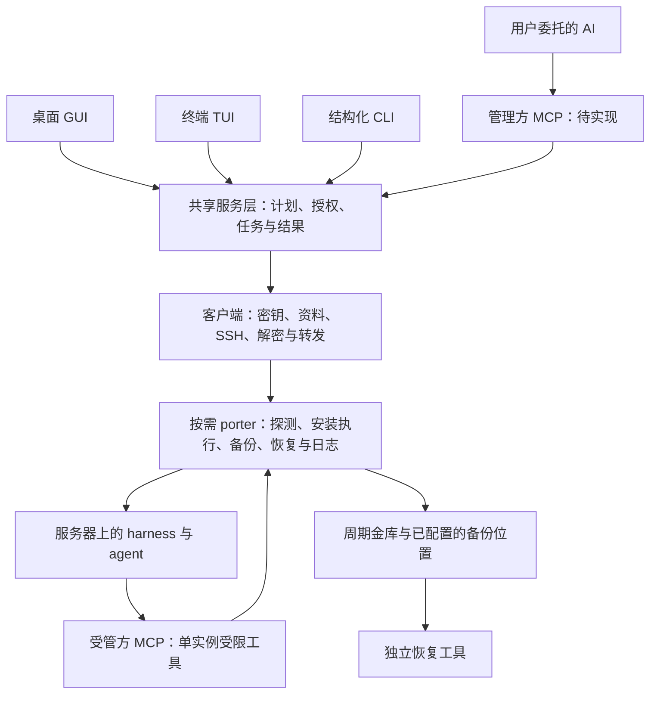

# Valise 产品与架构重整方案：带着你的 Agent 去旅行

> 已确认方向的讨论记录 · 2026-11-05
>
> 本稿保留产品定位、交付形态、时间轴与备份的讨论背景，取代本文件此前仅讨论备份收敛的版本。用户已确认草图与后端计划，并授权更新正式规范和开发排期；规则以 PRODUCT.md、ARCHITECTURE.md 等正式规范为准，进度以 DEV_PLAN.md N1–N5 为准。下文仍含候选细节，不能当作已发布 schema、已实现能力或新的权限授权。
>
> 2026-11-05 评审记录：用户确认新版 GUI / TUI 交互草图通过，包含旅程大页面、流动细线、节点柔光、从节点展开详情与方向翻页。草图见 `sketches/valise-journey-gui-tui-2026-11-05.html`。此项确认不代替后端数据语义、权限接口与实施排期的具体设计评审。
> 后续同日用户已明确“按这三项建议定稿，同步正式规范”，N1 具体契约现已定稿，见 [N1_SERVICE_CONTRACTS_2026-11-05.md](N1_SERVICE_CONTRACTS_2026-11-05.md) 第 14 节；本讨论记录不覆盖该定稿，N2–N5 实现与测试仍未完成。

## 1. 产品定位

**Valise 帮助缺少计算机系统管理经验的用户，在自己的服务器上搭好并照看 harness / agent；需要换环境时，带着熟悉的记忆、习惯与资料继续。**

品牌表达：**带着你的 Agent 去旅行。**

技术说明：连接服务器，安装或接入 harness，完成日常管理、备份、恢复与迁移。

这里的“旅行”是产品气质。关键操作仍使用“连接、安装、备份、恢复、迁移”等直接表达，不再要求用户学习空间站、逃生舱、着陆等术语。

### 1.1 用户应当得到什么

- 从零开始时，不需要先学 SSH 配置、端口转发和服务管理，就能走通已支持 harness 的安装与使用路径。
- 已经有 agent 时，可以接入已有环境，了解运行和保护情况，不被迫重装。
- 平时知道它是否运行、有没有需要处理的事、最近的状态是否被保存。
- 出问题或换服务器时，可以选择过去的时间点，知道能找回什么，以及还缺哪些条件。
- 想减少手动操作时，可以让另一个 AI 经受控接口协助管理 Valise。

安装可用、数据已备份、已有异地副本、恢复测试通过，是不同的结果。界面分别说明，不合并为一个“全部安全”。

### 1.2 保持克制

不做整机管理面板、云服务器销售平台、模型凭据管理器、聊天平台替代品或插件市场。不在备份过程中清洗会话、压缩记忆或判断哪些内容值得留下。

“让熟悉的 Agent 存续”是保护数据和运行连续性的目标，不承诺模型升级后行为完全相同，也不承诺任意 harness 之间无损转换记忆。

## 2. 交付形态：同一能力，不同操作入口

| 入口 | 面向谁、解决什么 | 产品职责 |
| --- | --- | --- |
| GUI | 最终交付给普通用户的桌面应用 | 完整引导、日常管理、时间轴、恢复与确认；基础任务不依赖用户另外打开 CLI |
| TUI | 资源紧凑、桌面不可用或偏好终端的环境 | 通过菜单、表单和列表降低认知负担；复用相同流程与状态，不照搬 GUI 的视觉布局 |
| 管理方 MCP | 用户委托操作 Valise 的另一个 AI | 读取状态、准备计划、发起已授权任务、获取进度与结果；受客户端权限边界约束 |
| CLI | 自动化、AI 适配、诊断及高级用户 | 提供稳定、可结构化消费的操作入口，保留兼容性；不再作为普通用户必须学习的主产品 |

TUI 是终端中的交互界面，仍需要可用终端和基础启动方式；不应向用户描述成无需任何终端条件的桌面 GUI。

CLI 服务机器操作的方向不意味着 MCP 必须模拟终端、解析人类输出。推荐 MCP 和 CLI 都作为共享服务层的薄适配；需要调用 CLI 时使用明确的结构化输入输出。对外的具体接口在实施前定稿。

业务能力在共享服务层完整，与“每个业务能力必须有同等复杂的人工 CLI 向导”分开。GUI 和 TUI 不以调用 CLI 作为唯一业务入口；原生交互程序按需要交还终端或转交原生页面。

### 2.1 两种 AI 角色不能混淆

- **管理方 AI**：用户的助手，在用户侧通过 Valise 操作已授权的服务器和 agent。当前属于规划，需要新增客户端接口。
- **受管 agent**：被 Valise 照看的对象，在服务器侧通过现有受限 MCP 查询自己的状态、请求备份、提议登记补充或进行交接。

两者不能因为都叫 MCP 就共用权限。受管 agent 不因此获得恢复、删除、读取凭据或任意文件写入能力。

“甩手掌柜”体验来自减少重复选择、保存设置与执行已批准计划，不来自把口令交给 AI 或让它绕过确认。常规读取和已允许的备份等可以直接完成；需要主人授权或管理登录的任务，按现行分级处理。AI 可准备完整计划，人只在需要的节点确认和解锁，不要求每一步点一次。

管理方接口不得读取秘密，不能自行开启高级模式。缺少用户确认条件时，返回明确的等待状态，GUI 不可用时由用户在可用的 TUI 或本地交互流程完成；不把“直接改用 SSH”作为绕过方案。确认如何传递和绑定计划属于待设计项，不能假定存在跨进程授权服务。

## 3. 两种起点，共享一个目标

首次入口保持两个明确选择：**从零开始**、**接入已有**。用户提供的是可登录的服务器，不要求 Valise 代购服务器或重新安装操作系统。

### 3.1 从零开始

1. 填写服务器地址、用户名与登录方式，或导入已有 SSH 配置。
2. 确认服务器身份，检查系统、架构、空间及安装条件，部署按需使用的 porter。
3. 选择已支持的 harness，说明安装位置、必要依赖、影响与支持程度。
4. 用户确认后，按已审核来源安装；需要系统依赖时沿用现有管理登录与高级模式规则。
5. 进入 harness 自己的初始化或管理页面，用户在原生流程完成模型与渠道设置。
6. 检测实际安装结果并接入，进入 agent 概览；引导设置默认备份、加密钥匙恢复材料与额外备份位置。

首次阶段结果是“能找到、能打开、知道接下来做什么”。原生设置尚未完成时如实显示，不因为安装命令退出就声称已经能对话。备份设置不阻塞用户先连接和查看环境；首次备份必须具备所需加密条件。

### 3.2 接入已有

1. 连接服务器并检查环境。
2. 按资料发现已有 harness 和实例，区分已接入、新发现及未找到目录的记录。
3. 展示本次识别的程序来源、状态范围、服务、管理入口和支持缺口。
4. 用户确认登记事实，保留现有程序、数据和配置。接入不隐式安装技能或修改 agent。
5. 进入同样的 agent 概览与保护设置流程。

识别不足时允许查看和有限接入，明确哪些操作尚未支持；不强迫重装，也不把生成一份 profile 当成已验证恢复能力。

### 3.3 两条路的共同完成标准

用户能找到自己的 agent、打开已支持的原生入口、看懂运行与保护状态，知道需要自己完成的设置。关键过程失败时停在实际失败步骤，并提供可执行的下一步。

## 4. 信息架构：Agent 是主角，服务器是运行地点

建议主要入口：

| 一级入口 | 主要内容 |
| --- | --- |
| 我的 Agent | 跨服务器的 agent 概览、待处理事项、打开原生入口、连接或安装新 agent |
| 服务器 | 连接、安装环境、共享 harness、受影响实例、访问与资源条件 |
| 备份位置 | 本机文件夹、外部磁盘、NAS 等位置，副本与同步状态、配置入口 |
| 工具箱 | 与 Valise 使用有关的技能、工具及可选扩展；按目标分组，明确安装范围 |
| 设置 | 加密钥匙与恢复材料、资料包、客户端设置、AI 接入和高级管理 |

服务器、安装和 agent 的层次继续在底层保留，日常不用层层点进去才能到达 agent。共享网关的停止或恢复会影响哪些实例，在计划中说明，不能为简化页面隐藏影响。

每个 agent 的主要视图：

| 视图 | 用户要回答的问题 |
| --- | --- |
| 概览 | 它在运行吗，如何打开，有什么需要处理？ |
| 旅程 | 过去保存了哪些状态，我要回到哪一个时间点？ |
| 健康 | 发现了什么问题，影响是什么，怎样处理？ |
| 管理与设置 | 已核实的管理动作、原生入口、保护计划和登记事实 |

“旅程”的副说明写“备份与恢复记录”；时间点的操作叫备份、恢复、迁移和导出。布局与标签待草图评审，本表不要求立刻改变现有导航。

内置聊天不作为核心依赖。首先把 harness 原生管理与对话入口打开；已有聊天转接规划保留为后续可选功能，不阻塞本次闭环。

## 5. 旅程与备份：一套默认保护，一条时间轴

### 5.1 默认内容

建议默认使用现有 `full` 范围：人格、记忆、技能、配置、完整会话、状态、已声明凭据、工作区和未分类文件。仅作用于已登记 roots；程序实体、已声明缓存与忽略项按现行范围处理。

一次日常保存产生一个时间点，不为不同档位分别安排多次备份。周期与 epoch 内复用相同数据块，每个时间点保存完整恢复清单，无需按日期逐次重放增量。保留旧档位与旧快照语义。

凭据可以随默认备份加密保存，不代表 Valise 提供 API Key 管理功能。未知内容按敏感数据处理，不能为了省空间猜测删除。

### 5.2 识别、档案与自定义

按 profile 识别通用结构，由服务器档案补足实际安装事实。剩余未知项已在默认范围时汇总说明，不要求逐文件分类；真正未覆盖的目录、不可读内容与外部引用，说明实际缺口。

自定义只在用户有特殊选择时使用，不成为可靠备份的前置任务。保存方案供以后使用，目录选择可以覆盖未来新增文件；具体范围和回滚语义仍需单独定稿。首版不自动扩展已有 roots，也不因勾选链接就跟随未知外部目标。

安装事实、备份选择、能否安全执行管理动作是不同信息。共享扫描结果，不把“已登记”或“已备份”当成操作安全许可。详见 B03 链接提案，具体能力按需扩展，不建立推断任意 harness 行为的万能引擎。

### 5.3 时间轴内容

以成功保存的时间点为主体，显示日期、已知原因、实际覆盖范围、副本和验证情况。失败任务可见，但不是恢复点；跳过或没有保存的时间段不能渲染成连续保护。

默认按时间浏览，周期折叠历史并作为存储与删除边界。主页只显示最近保护情况和重要缺口，备份不抢占日常使用的中心。

可以展示用户备注和已记录的操作原因，不读取对话来生成成长故事，不在备份路径上调用 LLM。服务器审计丢失时允许原因缺失，仍展示可独立读取的快照。

备份历史放在金库中，服务器档案保存当前安装事实与设置，不塞入全部历史。

### 5.4 建议的自动策略

首版建议向导提供“每天自动备份”的推荐设置，由用户确认后启用；时区、时间和可能停机在计划中说明。具体性能需要实测，不能仅因去重就声称全量读取没有成本。

已核实的修改动作继续沿用操作前备份，必要时会产生额外时间点。它们在时间轴按原因区分，不为了每天只有一个点而跳过风险操作前的保护，也不自动删除同日多余时间点。

原有定时器、MCP 与手动入口使用新默认策略的迁移须分别定义，不能只改 UI 标签。旧设置不静默改写；首次扩大范围说明新增覆盖及空间成本。客户端关闭时能否持续定时备份和直传、证书有效期以及依赖客户端中转的位置是否能更新，都要如实展示。

## 6. 恢复与迁移：选择时间点，再选择去处

- **恢复当前实例**：按该时间点的实际范围恢复，核对程序版本。新程序损坏不能只靠换回旧数据保证修好。
- **迁移到另一台服务器**：准备匹配的环境，暂存状态并校验，处理独占凭据与原实例切换，确认目标可用后完成。
- **创建副本**：产生独立实例，默认避免复制独占渠道身份；不把两个副本自动当成同一个 agent。
- **导出文件**：即使缺少可运行环境，仍可独立取回备份数据。排除已声明凭据不等于内容已脱敏或适合公开分享。

共用“计划—暂存—校验—确认—日志交换—结果复核”。失败分别报告数据、程序和服务状态；支持的场景沿用自动退回，不夸大多步骤交换的原子性。

迁移后的体验应当让用户理解同一段旅程在新位置继续。当前 instance_id 和周期按服务器组织，不能仅凭名字相同跨服务器合并历史。首版先用明确的迁移记录关联展示；完整的长期身份、分支与离线重建关联是后续数据设计项，未定前不承诺已实现跨服务器统一时间轴，也不因此改写旧快照。

不承诺跨任意版本、架构或 harness 恢复。展示经过核实的能力、兼容条件和缺口，所有恢复仍由确定性代码执行。

## 7. 健康、工具箱与记忆扩展

### 7.1 健康（含 Security Hub）

健康页汇总运行、备份与副本、恢复测试、已知安全设置，以及会话和记忆指标。按“什么情况—影响—原因—怎么处理”解释，提供已核实的处理动作，执行后重新检查；无法判断和未完成检查不能显示正常。

Security Hub 是集中呈现已知风险和处理入口的职责，不升级成通用漏洞扫描器或安全认证。没有问题不等于没有风险，不给出笼统安全分数。agent 自述与程序核实结果分开。

### 7.2 工具箱

保留已有工具检测、固定清单、技能和可选扩展的方向。按“为自己接入 AI 管理”“让受管 agent 知道自己受到保护”“辅助备份传输”“记忆与会话管理”等用途组织，弱化用户先理解基础/增强/专家级别的负担。

底层权限级别、来源校验和卸载归属仍保留。每项写明装在哪里、影响谁、需要什么权限、不装会怎样，以及如何卸载。不是插件市场，不提供任意插件解释器，不为第三方软件背书。

### 7.3 记忆与对话管理扩展

继续作为可选能力，可独立发布；不进入备份与恢复的必经路径。先利用 harness 原生机制，再提供明确范围的整理、交接或归档辅助。

任何记忆修改必须由用户同意、先备份，说明修改范围和恢复办法。完整会话按备份规则保存，不在封存时自动清洗。现有交接技能可复用，尚未开发的记忆插件不画成可用按钮。

## 8. 可复用的架构与需要补足的层

图中备份位置包括需客户端中转的情况，不承诺所有位置都能由服务器直接写入。管理方 MCP 是客户端适配，不新增远端常驻守护进程。

### 8.1 复用清单

| 设计或模块 | 处理意见 | 原因与限制 |
| --- | --- | --- |
| 系统 OpenSSH、按需 porter、控制与数据通道 | 复用 | 适合资源紧凑环境，不新增服务器监听端口 |
| 日常钥匙、主人证明、独立管理登录 | 复用 | 入口收敛不放宽服务器权限，不新增口令层 |
| profile、签名资料包、来源校验、安装与原生入口 | 复用并完善引导 | 继续把 harness 知识与执行引擎分开 |
| dossier 的安装 / agent 分层 | 复用 | 保留共享安装事实，界面减少层层导航 |
| 共享 Go 服务层 | 复用并扩展 | GUI、TUI、CLI 与新管理方 MCP 共用；任务模型不藏在命令处理函数里 |
| age、zstd、分块去重、周期金库与副本传输 | 复用 | 新时间轴主要改变默认策略与组织方式 |
| SQLite 副本、校验、暂存、交换日志、恢复工具 | 复用 | 产品变化不削弱灾难恢复基础 |
| 健康汇总、已核实修复与结果刷新 | 复用 | 可作为健康入口基础；B03 尚未全部验收 |
| 现有受管方 MCP 与四个技能 | 有条件复用 | 更新表达与保护状态；新备份默认值需明确设计和验证，不自动获得管理权限 |
| TUI 的视口、滚动、进度、错误与确认组件 | 复用 | 重组页面，保留最小终端可操作性 |
| GUI 框架 mygo 与已锁版本 | 保留选型 | 不因本稿换框架或升级；实现仍待正式重排里程碑 |

### 8.2 需要补足的通用能力

- 统一任务信息：操作目标、冻结计划、授权需求、阶段、可否取消、当前结果和可恢复入口；与现有 restore/action 日志对接，不用一个泛化引擎重写全部安全流程。
- 时间轴读取：组合快照、已有审计和恢复记录，隔离失败任务、过期结果及缺失来源。
- 默认保护计划：手动、定时与 AI 入口的范围和状态一致，范围变化可解释。
- 管理方 MCP：稳定结果、等待确认和中断后查询；具体工具清单及确认传递机制单独评审。
- GUI 的完整基础引导：把现有只能经终端处理的步骤改成最终用户能完成的流程，复用同一业务服务。

这些是待建设的产品能力，不声称当前实现已经具备。

## 9. 舍弃与优化

| 内容 | 建议 |
| --- | --- |
| 空间站、逃生舱、着陆等日常操作术语 | 舍弃主界面用语，改为备份位置、备份、恢复、迁移；内部标识与历史文件不必全局改名 |
| 为每种档位安排一套日常备份的产品模型 | 舍弃，采用一套充分默认范围；不是删除旧数据或删除底层显式档位能力 |
| CLI 功能数量代表产品完成度 | 舍弃，改以普通用户任务能否闭环和受控自动化能否工作为标准 |
| 必须逐文件解释未知内容才能继续 | 舍弃，默认保守保存、目录级说明实际缺口 |
| 时间轴依赖 LLM 分析对话生成成长故事 | 不采用，用已知事实和用户备注 |
| 航天专属进度文案与火箭动画作为主流程 | 替换，保留清楚的阶段、进度和错误，不让装饰延迟结果；旅行视觉待草图确认 |
| GUI 等到每个 CLI/TUI 边缘能力齐备才开始 | 优化，按完整用户任务分阶段交付；先稳定必要服务契约，不必等待所有可选扩展 |
| profile 枚举每台机器的特殊链接 | 优化为通用规则加安装事实，不为未知行为自动授权 |
| 工具箱三级清单和多层实例导航 | 优化展示顺序，底层风险分级与共享影响保留 |
| 备份、同步、验证、运行合成绿色徽标 | 不采用，继续分别显示 |

## 10. 现状、实施顺序与评审完成标准

本稿依据现行规范、模块位置及 DEV_PLAN 的已记录验收整理，不是对全仓代码的逐行审计。可复用不等于在新流程下已经通过验收。

当前基础：SSH、安装接入、备份、恢复、副本、服务层和 TUI 已有大量实现与实测记录；B02 有验收；B03 有实现和部分实测，但绝对链接阻塞未解决，正式入口未开放。自定义范围、管理方 MCP、GUI 交付与新时间轴尚未完成。本稿不把这些统称为现成能力。

2026-11-05 已确认后端顺序并同步到正式排期（具体依赖、开工条件及状态见 DEV_PLAN.md）：

1. **N1 规范与服务契约**：最初仅同步正式规范和排期；同日用户随后确认三项建议并要求定稿，具体契约与正式规范现已同步，N1 Done 仅指设计交付。身份、计划版本/并发、旅程/任务、恢复来源与授权绑定按 N1_SERVICE_CONTRACTS_2026-11-05.md 实现，N2–N5 尚未实现。新版 GUI / TUI 草图已通过，不重复设置同一草图评审。
2. **N2 Agent、默认保护与旅程**：跨服务器汇总，用户确认的 full 默认计划、可配置定时器和可重建时间轴；旧设置显式迁移。
3. **N3 副本与离线恢复来源**：严格核对副本，自动同步下沉共享服务，从完整副本独立准备恢复材料，验证原服务器失联场景。
4. **N4 GUI 完整交付与 TUI 对齐**：M7b 并入本阶段，按必要契约与闭环验收推进，不等全部 TUI 边缘功能；正式进入本阶段前不引入 mygo，版本仍锁 v0.7.3。
5. **N5a–N5c 自动化与扩展**：结构化 CLI / 管理方 MCP、自定义范围及可选增强分项推进；设计可提前，可执行交付依赖稳定的服务与各自具体评审。

B03 保留原实现和验收证据，外部链接机制单独设计核实。独立查询不受其阻塞；依赖同一暂存/链接机制的动作和恢复路径须通过对应验收才开放。

评审后的验收场景：

| 场景 | 用户应能完成的结果 |
| --- | --- |
| 空服务器 | 在 GUI 走完已支持的安装引导，打开原生管理入口，知道尚待完成的设置 |
| 已有 agent | 接入时不重装、不修改记忆，能看懂发现和保护缺口 |
| 日常保护 | 一次设置后按计划保存，已批准的后台任务不要求每天重选档位；失败与副本延迟可见 |
| 找回过去 | 从时间轴选一点，理解范围和目标，恢复结果如实显示 |
| 更换服务器 | 按明确兼容条件准备环境、恢复资料、处理原实例和独占身份，关联展示迁移事实 |
| 原服务器丢失 | 从完整副本及恢复材料读取历史和取回数据，不依赖原 dossier 存活 |
| AI 代管 | 查询和已授权任务可完成，需确认的任务停在正确节点，不接触口令或绕过限制 |
| 小终端与失败恢复 | TUI 能看全计划并操作，断连后的恢复依据持久日志，不依赖动画或前端内存 |

## 11. 已确认的方向与后续边界

- 定位是否准确：首先帮助非运维用户搭好并照看自己的 agent，可靠备份与可迁移性贯穿全程。
- 入口是否准确：GUI 是最终用户交付，TUI 服务资源受限场景，CLI/MCP 服务受控自动化。
- 信息架构是否顺手：我的 Agent 为日常起点，服务器仍可管理，旅程承载历史与恢复。
- 默认是否足够省心：充分范围、推荐自动备份、实际缺口才提升提醒，自定义作为补充。
- 品牌表达是否适合：旅行意象集中在旅程与产品气质，关键操作保留直接名称。
- 复用与舍弃是否合理：保留可靠执行底座，重做组织与默认体验，不靠重写底层来证明改版。

已确认产品方向、草图和后端顺序，不等于一次批准所有待定 schema 或新权限；后续按正式规范完成具体设计，不重复询问已经确定的方向。本次已更新正式规范与开发排期，未修改执行代码、部署、提交或推送。
